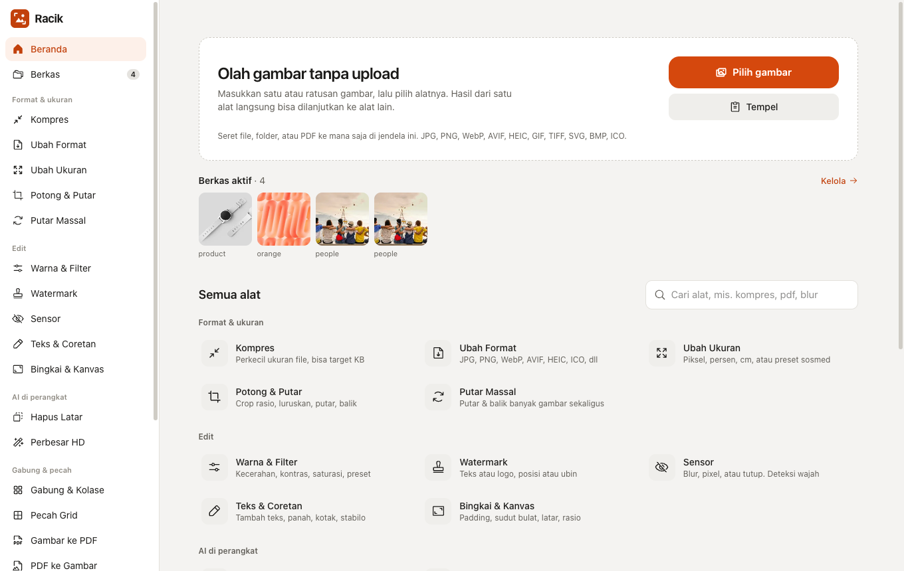

# Racik — Image Tools

[](https://www.typescriptlang.org/)
[](https://react.dev/)
[](https://webassembly.org/)
[](docs/teknis.md)
[](docs/teknis.md)
[](LICENSE)
[](https://github.com/rizalahmaddd/img-tools/actions/workflows/ci.yml)
[](https://image.solusikoding.com)

<p align="center">
  
</p>

**Stack:** TypeScript · React 19 · Vite · Tailwind CSS · [jSquash](https://github.com/jamsinclair/jSquash) (MozJPEG, libwebp, libavif, libjxl, OxiPNG via WebAssembly) · [Transformers.js](https://huggingface.co/docs/transformers.js) · [ONNX Runtime Web](https://onnxruntime.ai/) (WebGPU) · [MediaPipe](https://ai.google.dev/edge/mediapipe) · [pdf-lib](https://pdf-lib.js.org) · [PDF.js](https://mozilla.github.io/pdf.js/) · Workbox (PWA) · Cloudflare Workers

Toolbox pengolahan gambar 100% client-side langsung di browser. Kompres, ubah format, potong, sensor, hapus latar, sampai perbesar resolusi dengan AI, semuanya berjalan di perangkat Anda tanpa satu pun gambar diunggah ke server. Bisa dipasang sebagai aplikasi (PWA) dan tetap jalan offline setelah kunjungan pertama.

🌐 **Coba demo:** [image.solusikoding.com](https://image.solusikoding.com)

## Fitur

### Format & ukuran
- **Kompres**: Perkecil ukuran file berdasarkan kualitas atau target ukuran (KB)
- **Ubah Format**: Konversi ke JPG, PNG, WebP, AVIF, JXL, GIF, BMP, TIFF, dan ICO
- **Ubah Ukuran**: Atur dimensi dalam piksel, persen, cm, atau preset media sosial
- **Potong & Putar**: Crop dengan rasio, luruskan kemiringan, putar, dan balik gambar
- **Putar Massal**: Putar dan balik banyak gambar sekaligus

### Edit
- **Warna & Filter**: Kecerahan, kontras, saturasi, ketajaman, dan preset filter
- **Watermark**: Tanda air teks atau logo, di satu posisi atau berulang (ubin)
- **Sensor**: Blur, pixelate, atau tutup area sensitif, dengan deteksi wajah otomatis
- **Teks & Coretan**: Tambahkan teks, panah, kotak, dan stabilo
- **Bingkai & Kanvas**: Padding, sudut bulat, warna latar, dan ubah rasio kanvas

### AI di perangkat
- **Hapus Latar**: Latar transparan, ganti warna, blur, atau gambar lain (model MODNet & BiRefNet)
- **Perbesar HD**: Upscale 2×–4× dengan Real-ESRGAN, memakai GPU (WebGPU) bila tersedia

### Gabung & pecah
- **Gabung & Kolase**: Sambung gambar ke samping, ke bawah, atau susun dalam grid
- **Pecah Grid**: Potong gambar jadi kotak-kotak, cocok untuk carousel Instagram
- **Gambar ke PDF**: Satukan banyak gambar menjadi satu dokumen PDF
- **PDF ke Gambar**: Ambil setiap halaman PDF menjadi gambar
- **Buat GIF**: Animasi GIF dari beberapa gambar

### Utilitas
- **Info & EXIF**: Lihat metadata kamera dan lokasi GPS, lalu hapus tanpa menurunkan kualitas
- **Palet Warna**: Ambil warna dominan dan pipet warna dari gambar
- **Ikon & Favicon**: Buat paket favicon dan ikon aplikasi Android/iOS
- **Base64**: Konversi gambar ↔ Base64 / Data URL

### Lainnya
- **Hasil bisa dirangkai**: Output satu alat langsung jadi input alat berikutnya, lengkap dengan riwayat versi dan undo/redo
- **Proses massal**: Masukkan puluhan sampai ratusan gambar, proses sekaligus, unduh sebagai ZIP atau simpan ke folder
- **Banyak format masuk**: JPG, PNG, WebP, AVIF, HEIC/HEIF, GIF, BMP, TIFF, SVG, ICO, JXL, dan PDF
- **Masukkan dari mana saja**: Pilih file, seret file atau folder, tempel dari clipboard, atau bagikan langsung dari galeri HP
- **100% offline & privat**: Tidak ada server pemroses; aman untuk foto pribadi, dokumen identitas, dan aset klien
- **PWA & responsif**: Bisa dipasang di desktop maupun HP, dengan tema terang/gelap

## Cara kerja

1. Buka [image.solusikoding.com](https://image.solusikoding.com) atau pasang sebagai aplikasi.
2. Masukkan satu atau banyak gambar (pilih, seret, atau tempel).
3. Pilih alat, atur sesuai kebutuhan, dan lihat pratinjaunya langsung.
4. Lanjutkan ke alat lain bila perlu, lalu simpan hasilnya.

## Mulai cepat

```bash
npm install       # pasang dependensi
npm run dev       # jalankan di http://localhost:5173
npm run build     # build produksi ke folder dist/
```

## Dokumentasi

- [Dokumentasi Teknis](docs/teknis.md): arsitektur, engine pemrosesan, AI di perangkat, PWA, build & deploy, serta lisensi model

## Dukung & Donasi

Jika proyek ini bermanfaat bagi Anda, dukung pengembangannya melalui **QRIS**:

<p align="center">
  
  <br>
  <em>Scan QRIS menggunakan BCA, Mandiri, BRI, GoPay, OVO, DANA, ShopeePay, atau mobile banking lainnya.</em>
</p>

## Kontak

Dikembangkan oleh **rizalahmaddd**:
- **WhatsApp**: [+62 857-7777-5477](https://wa.me/6285777775477)
- **GitHub**: [@rizalahmaddd](https://github.com/rizalahmaddd)
- **Lokasi**: Kota Malang, Jawa Timur, Indonesia

## Lisensi

Proyek ini dilisensikan di bawah lisensi [MIT License](LICENSE).  
Model AI yang dipakai memiliki lisensinya masing-masing, rinciannya ada di [Dokumentasi Teknis](docs/teknis.md#7-model-ai--lisensi).
